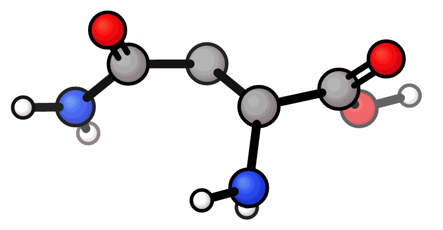
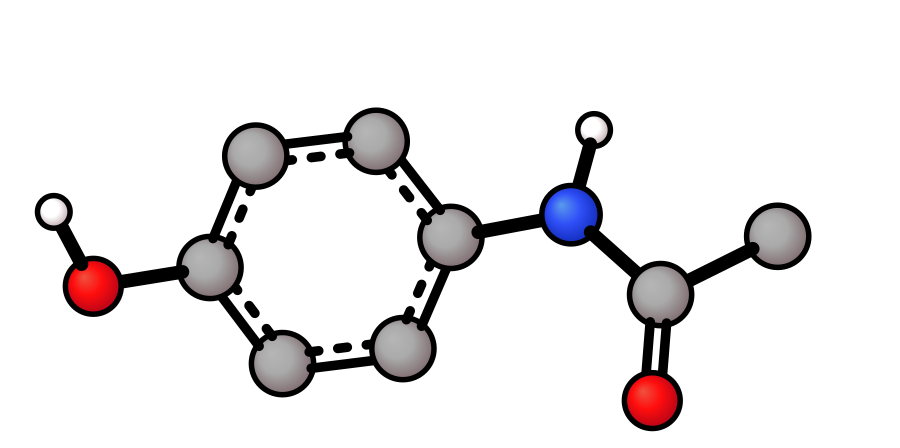
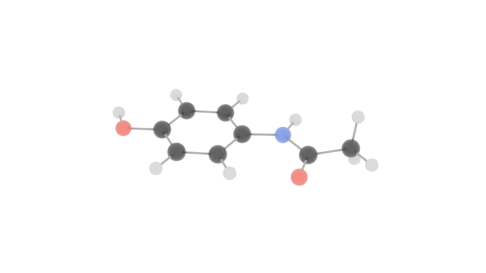
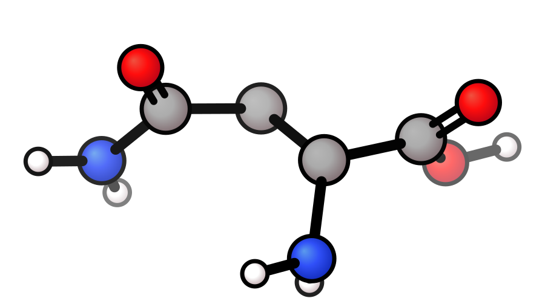
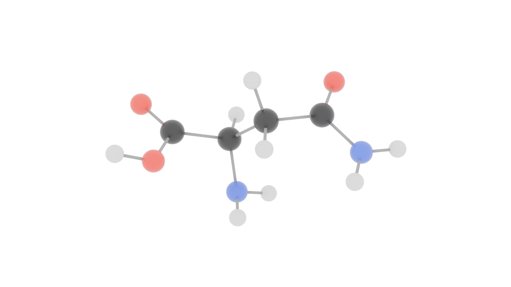
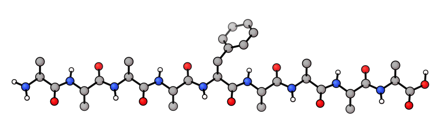
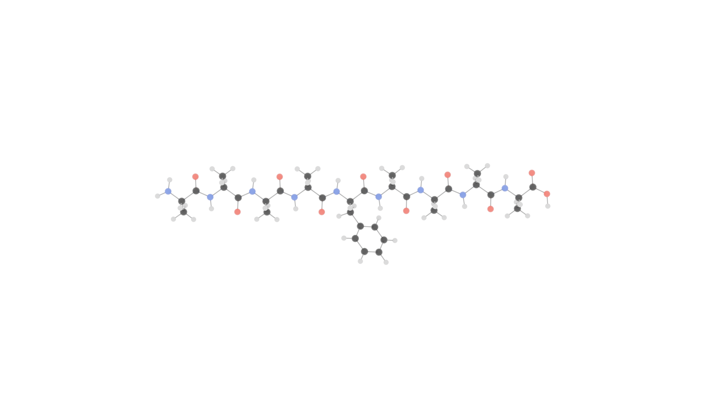
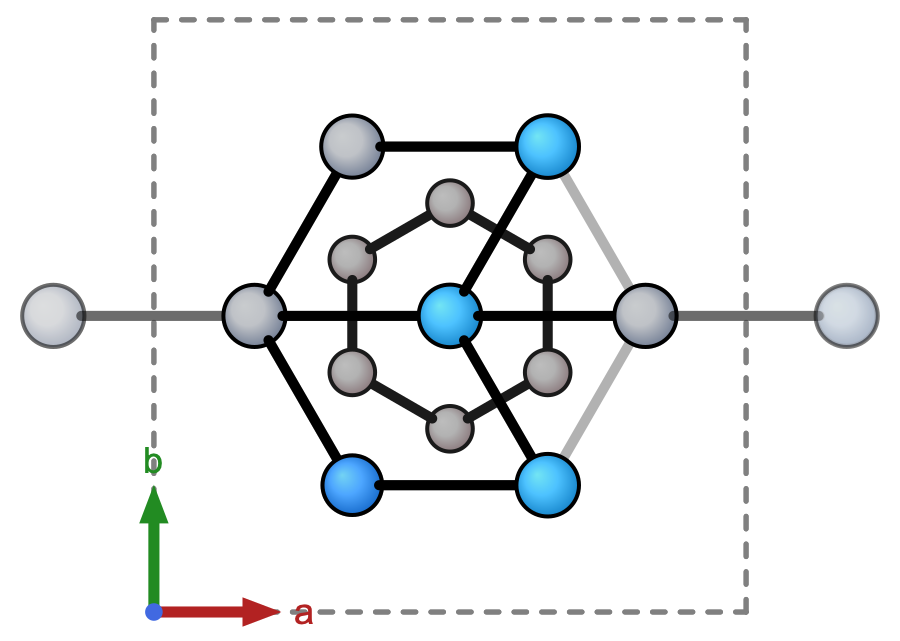
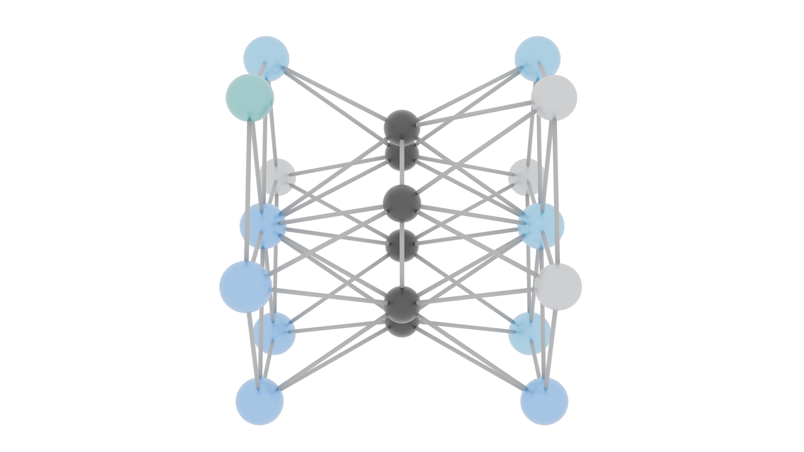

# Molecular Visualization Study

<p align="center">
  
</p>

<p align="center">
  <strong>A terminal-to-Blender visual testing case study</strong><br>
  Molecular structures were rendered through two workflows, then compared for topology, depth, framing, and scientific readability.
</p>

> **Portfolio scope:** this repository documents my testing and visual-evaluation work from a private collaboration. It is deliberately a non-code case study: the underlying software was implemented by Mark Jones / Molecular Quantum Solutions (MQS) and is not redistributed here.

## My contribution

I worked as the tester and visual reviewer rather than the software developer. My role was to:

- run chemically different structures through the terminal-preview and Blender-rendering workflows;
- compare rapid 2D/rotating previews with higher-fidelity 3D output;
- test difficult framing cases, including a planar molecule, a non-planar molecule, a long peptide-like chain, and a periodic crystal model;
- evaluate camera orientation, occlusion, scale, background, and visual legibility;
- rerun comparison cases after revisions and record where each representation was most useful.

The application architecture and code were created by **Mark Jones / Molecular Quantum Solutions**. The public presentation and documentation in this repository were prepared with **Codex** from my local test outputs. The molecular images are renderer output, not generative-AI artwork.

## Question

How do a fast terminal-driven molecular preview and a Blender render complement one another?

```text
molecular coordinates
        │
        ├── fast preview ──► topology, bonds, axes, quick rotation
        │
        └── Blender render ► depth, occlusion, lighting, presentation
                              │
                              └── compare, diagnose, rerun
```

The goal was not to decide that one view is universally “better.” A fast schematic preview can expose connectivity clearly; a lit 3D render can make spatial arrangement easier to perceive. Both can also introduce ambiguity if camera angle, perspective, bond detection, or lighting is poorly chosen.

## Four comparison cases

| Case | Why it was included | Main visual question |
|---|---|---|
| Paracetamol | Mostly planar, familiar small molecule | Does the 3D view preserve a readable molecular skeleton? |
| Asparagine | Compact and non-planar | Do depth and atom overlap remain understandable? |
| Peptide-like chain | Long, anisotropic structure | Can the camera avoid an edge-on or excessively distant view? |
| Periodic crystal model | Repetition and unit-cell context | Does a clean beauty render lose useful crystallographic context? |

### Paracetamol — topology versus depth

| Fast preview | Blender render |
|---|---|
|  |  |

The preview makes the ring and bond order easy to scan. The Blender view adds depth and a gentler material treatment, but lighting and framing must not hide the underlying chemistry.

### Asparagine — non-planar geometry

| Fast preview | Blender render |
|---|---|
|  |  |

This case was useful for checking overlap. Rotation helps confirm that apparent collisions in a single view can be projection effects rather than incorrect coordinates.

### Extended chain — camera framing

| Fast preview | Blender render |
|---|---|
|  |  |

Long structures exposed the strongest camera problem: a generic angle can compress the chain or waste most of the frame. A geometry-aware orientation makes comparisons more repeatable, but it is still a presentation choice—not a chemical calculation.

### Crystal model — context versus presentation

| Fast preview | Blender render |
|---|---|
|  |  |

The preview retains axis and cell context. The Blender render communicates spatial repetition more immediately, but should not replace a crystallographic plot when exact lattice information matters.

## What I learned

1. **Camera choice is part of scientific communication.** A technically correct model can still be misleading when viewed edge-on or with severe overlap.
2. **A polished render is not automatically more informative.** Lighting, transparency, and soft materials can obscure bonds or flatten atom contrast.
3. **Different structures need different checks.** Planar, non-planar, elongated, and periodic cases reveal different failure modes.
4. **Rotation is diagnostic.** It helps distinguish projection artifacts from problems in coordinates or connectivity.
5. **Rendering is downstream of chemistry.** These images visualize supplied coordinates and inferred/displayed bonds; they do not validate electronic structure, energetics, or molecular stability.

## Evidence and limitations

- The gallery contains outputs from local test runs in July 2026.
- No underlying MQS source code, private molecular data, or Blender scene files are included.
- Molecule names describe the test files used locally; this repository does not independently verify provenance or chemical accuracy of every coordinate set.
- Visual comparison is qualitative. It is not a benchmark of computational chemistry accuracy or renderer performance.
- Colors and atom sizes are visualization conventions, not measured electron densities or atomic boundaries.

See [STUDY_NOTES.md](STUDY_NOTES.md) for the test matrix and [ATTRIBUTION.md](ATTRIBUTION.md) for the collaboration boundary.

## Repository map

```text
assets/              selected terminal and Blender outputs
study_manifest.json  structured record of the comparison set
STUDY_NOTES.md       observations and limitations
ATTRIBUTION.md       roles, ownership, and reuse note
```

